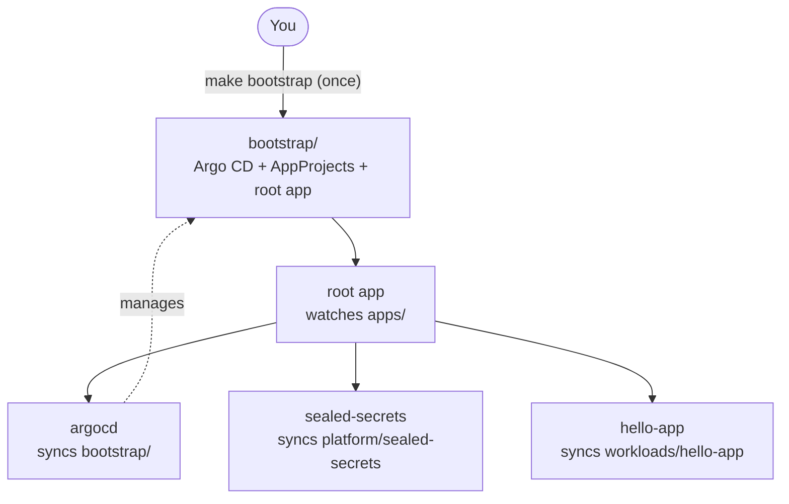

# argocd-gitops

> A small, working Argo CD setup that uses the App-of-Apps pattern. Everything in the cluster, including Argo CD itself, is managed from this Git repository.

[](https://github.com/hoangbeard/argocd-gitops/actions/workflows/validate.yml)
[](https://github.com/hoangbeard/argocd-gitops/actions/workflows/security.yml)
[](https://scorecard.dev/viewer/?uri=github.com/hoangbeard/argocd-gitops)
[](LICENSE)

## Why

Many Argo CD guides stop after `kubectl apply`. Then the setup drifts: someone changes a setting by hand, and nobody knows what is running.

This repository is a starting point where:

- You run **one command, once**. After that, every change goes through Git.
- Argo CD **manages itself**. You upgrade it with a commit.
- Secrets live in Git **encrypted**, with [Sealed Secrets](https://github.com/bitnami-labs/sealed-secrets).
- Teams are kept apart with **AppProjects**. A team app cannot deploy to `kube-system`.
- Every version is **pinned**, and CI checks every manifest before merge.

## Quick start

You need [Docker](https://docs.docker.com/get-docker/), [kind](https://kind.sigs.k8s.io/), `kubectl` and `make`.

```bash
# 1. Fork this repo, then point the apps at your fork
make set-repo REPO=https://github.com/<you>/argocd-gitops.git
git commit -am "chore: use my fork" && git push

# 2. Create a local cluster and install Argo CD
make kind-up
make bootstrap

# 3. Open the UI (user: admin)
make password
make ui        # http://localhost:8080
```

After a minute or two, `make status` shows four apps, all `Synced` and `Healthy`:

```
NAME             SYNC STATUS   HEALTH STATUS
argocd           Synced        Healthy
hello-app        Synced        Healthy
root             Synced        Healthy
sealed-secrets   Synced        Healthy
```

Now try GitOps. Change `PODINFO_UI_MESSAGE` in `workloads/hello-app/kustomization.yaml`, commit and push. Argo CD rolls out the new message within about a minute (`make sync` makes it check right away).

```bash
kubectl -n app-hello port-forward svc/hello-app 9898:80
open http://localhost:9898
```

## How it works



1. `make bootstrap` applies `bootstrap/`: the official Argo CD manifests, a few patches, the AppProjects and the **root** Application.
2. The root app watches `apps/`. Each file there is an Application, so Argo CD creates one app per file. This is the App-of-Apps pattern.
3. One of those apps, `argocd`, points back at `bootstrap/`. From now on, Argo CD keeps itself in line with Git.

## Repository layout

| Path | What it holds | Who changes it |
|---|---|---|
| `bootstrap/` | Argo CD install (pinned version), settings patches, root app | Platform team |
| `projects/` | AppProjects: `platform` (cluster-wide tools) and `workloads` (team apps) | Platform team |
| `apps/` | One Application per file. The root app syncs this folder | Anyone adding an app |
| `platform/` | Manifests for cluster-wide tools, such as Sealed Secrets | Platform team |
| `workloads/` | Manifests for team apps. `hello-app` is the example | App teams |
| `scripts/` | Bootstrap, cleanup, sealing secrets, switching to your fork | |

## Common tasks

### Add an app

1. Put its manifests in `workloads/<name>/` (plain YAML with a `kustomization.yaml`).
2. Copy `apps/hello-app.yaml` to `apps/<name>.yaml`. Change the name, the path and the namespace. The namespace must start with `app-`.
3. Add the new file to `apps/kustomization.yaml`.
4. Commit and push.

### Add a secret

Never commit a plain Secret. Seal it first. Only the controller in your cluster can decrypt it.

```bash
make seal NS=app-hello NAME=hello-app-secret DATA="API_TOKEN=change-me" \
  > workloads/hello-app/sealed-secret.yaml
```

Then uncomment `- sealed-secret.yaml` in `workloads/hello-app/kustomization.yaml`, commit and push. `hello-app` mounts the secret at `/etc/hello-app/secret`.

A sealed secret only works in the cluster that sealed it. If you rebuild the cluster, seal your secrets again, or [back up the sealing key](https://github.com/bitnami-labs/sealed-secrets#how-can-i-do-a-backup-of-my-sealedsecrets).

### Upgrade Argo CD

Change the version in the URL in `bootstrap/kustomization.yaml`, then commit and push. Read the [upgrade notes](https://argo-cd.readthedocs.io/en/stable/operator-manual/upgrading/overview/) first.

### Change Argo CD settings

Edit the files in `bootstrap/patches/`, then commit and push.

### Check before you push

```bash
make validate   # needs kustomize and kubeconform
```

CI runs the same check on every push and pull request.

## Security notes

This setup is built for learning and for a starting point. Before you use it in production:

- **Turn on TLS.** `bootstrap/patches/argocd-cmd-params-cm.yaml` serves the UI over plain HTTP, for local port-forward only.
- **Turn off the admin account.** Set up SSO, then set `admin.enabled: "false"` in `bootstrap/patches/argocd-cm.yaml`.
- **Back up the Sealed Secrets key.** Without it, nobody can decrypt the secrets in Git after a cluster rebuild.
- **Keep the `workloads` project tight.** Team apps can only use `app-*` namespaces, and can only create Namespaces at cluster level.
- **Private repositories** need credentials. Store them as a sealed `repo-creds` Secret ([docs](https://argo-cd.readthedocs.io/en/stable/operator-manual/declarative-setup/#repository-credentials)). Never commit an SSH key.
- **Pod security:** `app-hello` enforces the Kubernetes `restricted` profile. `hello-app` runs as non-root, with a read-only root file system and no Linux capabilities.

## Clean up

```bash
make kind-down   # delete the local kind cluster
make cleanup     # or: remove all apps and Argo CD from the current cluster
```

## Versions

| Component | Version |
|---|---|
| Argo CD | v3.5.5 |
| Sealed Secrets | v0.40.0 |
| podinfo (example app) | 6.15.0 |

## License

[MIT](LICENSE) © Pham Huy Hoang (HoangBeard)
